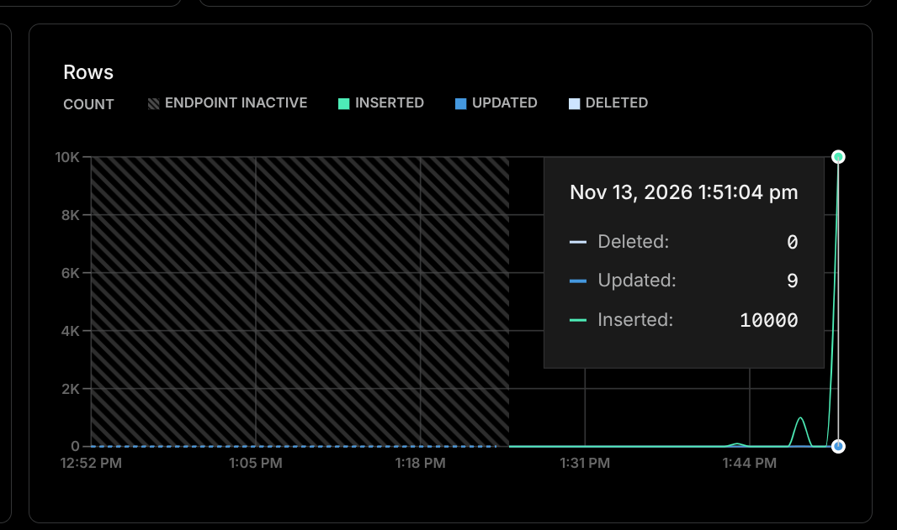

# B2B Invoice API

A Go REST API for inserting batches of B2B invoices into PostgreSQL. Uses `pgx.CopyFrom` for efficient bulk insertion.

## Features

- Batch invoice insertion
- Input and payment validation
- Automatic transaction-status calculation
- Atomic database writes using a transaction
- PostgreSQL `COPY` for bulk inserts

## API

### `POST /invoices`

Send an array of invoices:

```json
[
  {
    "customer": "Acme Ltd",
    "invoice_no": "INV-001",
    "required_amount": 10000,
    "paid_amount": 2500,
    "due_date": "2026-12-01"
  }
]
```

The API calculates the transaction status and completion date. Successful requests return:

```json
{
  "message": "Invoices created successfully",
  "count": 1
}
```

## Performance

An observed test inserted **10,000 invoices in approximately 2.8 seconds** (about **3,571 invoices/second**). This is a single observed result, not a standardized benchmark; results depend on application, network, and database conditions.



## Deployment

| Service | Free-tier resources |
|---|---|
| [Render Free web service](https://render.com/docs/compute-plans) | 0.1 CPU, 512 MB RAM |
| [Neon Free PostgreSQL](https://neon.com/pricing) | 1 GB storage, 100 CU-hours per project/month, autoscaling up to 2 CU (about 8 GB RAM) |

[Render free web services](https://render.com/docs/free) spin down after 15 minutes without traffic, so the first request after inactivity may be slower. These are provider plan limits, not measured resource usage during the insert test.


## Run locally

Set your environment variables:

```env
DATABASE_URL=your_neon_connection_string
PORT=8080
```

Then run:

```bash
go mod download
go run .
```

## Stack

Go · Gin · PostgreSQL · pgx v5
